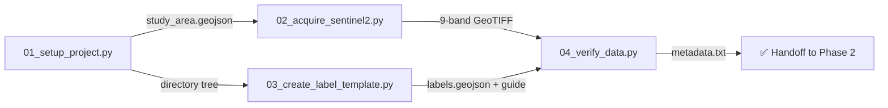

# Phase 1 — Data Acquisition & Ground-Truth Labeling Pipeline

**Project:** Crop Mapping & Water Quality Monitoring via Sentinel-2  
**Study Area:** Kothri Kalan, Sehore District, Madhya Pradesh, India  
**CRS:** EPSG:32643 (WGS 84 / UTM Zone 43N) · **Resolution:** 10 m × 10 m  
**Season:** Rabi 2026 (Jan 15 – Mar 10, 2026)

> [!IMPORTANT]
> This is **Phase 1 only** — data acquisition, cloud masking, compositing, and label schema creation. Phase 2 (feature engineering / model training) depends on the outputs produced here.

---

## Pipeline Architecture



---

## Quick Start

```bash
# 1. Install dependencies
pip install -r requirements.txt

# 2. Create project folders & study-area polygon
python 01_setup_project.py

# 3. Download & composite Sentinel-2 imagery
python 02_acquire_sentinel2.py              # Microsoft Planetary Computer (default)
python 02_acquire_sentinel2.py --stac copernicus  # or Copernicus Data Space

# 4. Generate annotation template & guide
python 03_create_label_template.py

# 5. Verify outputs & generate metadata for handoff
python 04_verify_data.py
```

---

## Directory Layout

```
rs_pipeline_kothri_kalan/
├── 01_setup_project.py           ← Deliverable 1
├── 02_acquire_sentinel2.py       ← Deliverable 2
├── 03_create_label_template.py   ← Deliverable 3
├── 04_verify_data.py             ← Deliverable 4
├── requirements.txt
├── README.md
└── data/
    ├── 01_raw/
    │   ├── study_area.geojson                    ← ~20 km × 20 km AOI (UTM 43N)
    │   ├── S2_KothriKalan_Rabi_2026_10m.tif      ← 9-band median composite
    │   └── metadata.txt                          ← Verification report
    ├── 02_interim/
    ├── 03_composites/
    ├── 04_labels/
    │   ├── labels.geojson                        ← Annotation template (5 classes)
    │   └── ANNOTATION_GUIDE.txt                  ← QGIS digitisation instructions
    ├── 05_patches/
    ├── notebooks/
    ├── scripts/
    ├── models/
    ├── outputs/
    └── docs/
```

---

## Script Details

### Deliverable 1 — `01_setup_project.py`
Creates the full directory tree and writes `data/01_raw/study_area.geojson`: a ~20 km × 20 km bounding box centred on **23.07°N, 76.85°E** (Kothri Kalan), reprojected to EPSG:32643.

### Deliverable 2 — `02_acquire_sentinel2.py`
| Step | Description |
|------|-------------|
| **STAC Search** | Queries Planetary Computer (or Copernicus CDSE) for Sentinel-2 L2A scenes within the AOI, Jan 15 – Mar 10 2026, cloud cover < 10% |
| **Band Loading** | Loads B02–B08 at native 10 m; loads B05, B06, B07, B11, B12 from 20 m with bilinear resampling to 10 m |
| **Cloud Masking** | Masks SCL classes 3 (cloud shadow), 8 (cloud medium), 9 (cloud high), 10 (cirrus) as NaN |
| **Compositing** | Per-pixel temporal median across all scenes, skipping NaN |
| **Scaling** | Divides by 10 000 → Float32 reflectance in \[0, 1\] |
| **Output** | Single 9-band Cloud-Optimised GeoTIFF with DEFLATE compression |

**Output bands:** B02, B03, B04, B05, B06, B07, B08, B11, B12

### Deliverable 3 — `03_create_label_template.py`
Generates `data/04_labels/labels.geojson` (EPSG:32643) with schema:

| `class_id` | `class_name` | Description |
|-----------|-------------|-------------|
| 1 | Active Crop | Green Rabi fields (wheat, gram, mustard) |
| 2 | Fallow/Bare Land | Harvested or barren plots |
| 3 | Built-up/Roads | Villages, roads, infrastructure |
| 4 | Clean Water | Clear reservoirs, ponds, rivers |
| 5 | Turbid/Algal Water | Silty, sediment-laden, or algal water |

Also writes a detailed **ANNOTATION_GUIDE.txt** covering QGIS false-color composite setup (B08-B04-B03) and digitisation best practices.

### Deliverable 4 — `04_verify_data.py`
Validates the stacked GeoTIFF against expected specifications:
- ✓ 9 bands present
- ✓ CRS = EPSG:32643
- ✓ Pixel resolution ≈ 10 m × 10 m
- ✓ dtype = float32
- ✓ NaN% per band < 50%
- ✓ Label schema integrity

Writes `data/01_raw/metadata.txt` with full pass/fail report + handoff notes for Phase 2.

---

## Class Schema Summary

```
┌────────┬──────────────────────┬────────────┐
│ ID     │ Class Name           │ Hex Color  │
├────────┼──────────────────────┼────────────┤
│  1     │ Active Crop          │ #00FF00    │
│  2     │ Fallow / Bare Land   │ #D2B48C    │
│  3     │ Built-up / Roads     │ #FF0000    │
│  4     │ Clean Water          │ #0000FF    │
│  5     │ Turbid / Algal Water │ #00CED1    │
└────────┴──────────────────────┴────────────┘
```

---

## Dependencies

See `requirements.txt`. Core stack: **geopandas**, **rasterio**, **rioxarray**, **odc-stac**, **pystac-client**, **planetary-computer**, **xarray**, **numpy**.
